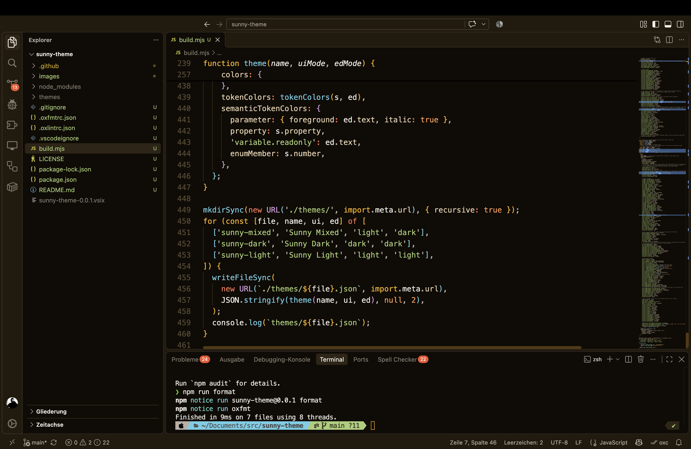
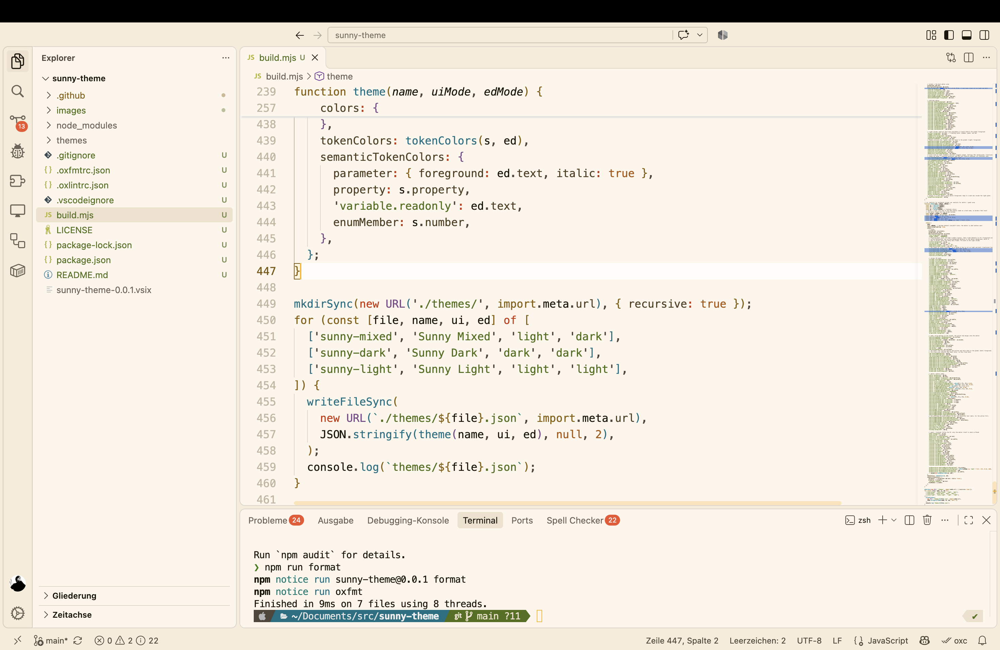
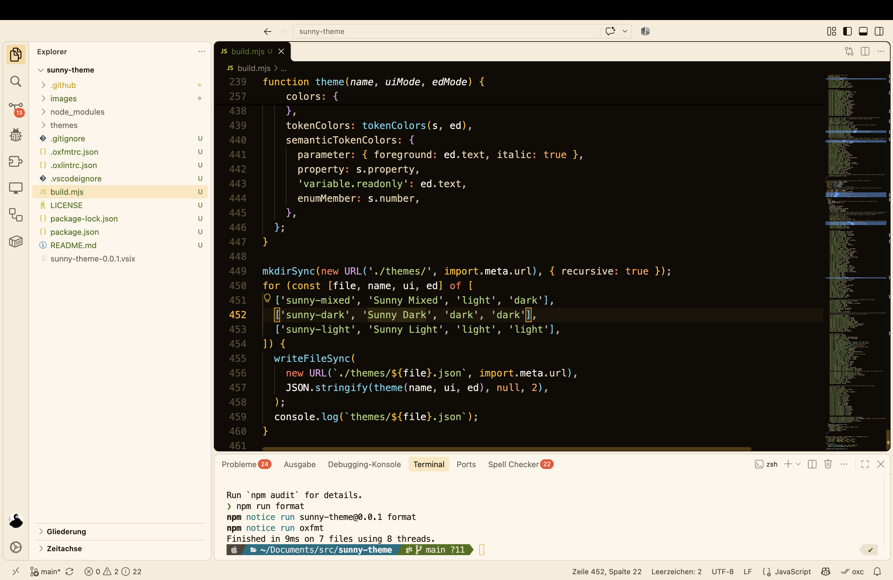

# 🌞 Sunny

> A VS Code color theme built from the Sunny theme palette used on [weblogixx.de](https://weblogixx.de).

| Theme           | UI    | Editor | Status       |
| --------------- | ----- | ------ | ------------ |
| **Sunny Dark**  | dark  | dark   | Stable       |
| **Sunny Light** | light | light  | Stable       |
| **Sunny Mixed** | light | dark   | Experimental |

## Install

1. Download `sunny-theme-<version>.vsix` from the [latest release](https://github.com/weblogixx/sunny-theme/releases/latest).
2. In VS Code, run **Extensions: Install from VSIX…** and pick the file.
3. Run **Preferences: Color Theme** and pick Sunny Dark, Sunny Light or Sunny Mixed.

### iTerm2

The same terminal colors as a preset: [`iterm/sunny-dark.itermcolors`](iterm/sunny-dark.itermcolors)
and [`iterm/sunny-light.itermcolors`](iterm/sunny-light.itermcolors).

1. Download the file and double-click it. iTerm2 imports it as a color preset.
2. In **Settings → Profiles → Colors → Color Presets…**, pick Sunny Dark or Sunny Light.

## Screenshots

### Sunny Dark

A 70s-inspired theme with yellow as its primary color and a brownish retro tint for larger backgrounds.

### Sunny Light

The same palette on cream backgrounds, with the yellow darkened so it stays readable as text.

### Sunny Mixed (Experimental)

Mixes the clean, creamy light surface with the dark editor.

VS Code has no background color for code files alone: `editor.background` paints the whole editor area. So in Sunny Mixed, everything that opens as an editor is dark (code, Settings, extension pages, the Markdown preview).

The sidebar, activity bar, panel, terminal, menus and status bar are light. The Output view is a text editor too, so it stays a dark box inside the light panel. Icons and links appear on both light and dark backgrounds, so they use a mid-tone grey and Sunny red, which can look a little flat in places.

## Colors

- **Sunny yellow** `#FDB515`: keywords, cursor, selection, buttons
- **Sunny red** `#F0532D`: operators, tags, badges, errors
- **Neutrals:** the site's background, surface, border and text steps, faintly tinted toward the yellow hue.

For syntax highlighting the theme adds a few 70s colors at the same lightness and chroma: avocado (strings), teal (functions), plum (types), burnt orange (numbers) and aqua (escapes, regex). Comments are a muted warm grey in italics.

## Contributing

Building, testing locally and releasing are described in [CONTRIBUTING.md](CONTRIBUTING.md).

## License

[MIT](LICENSE)
